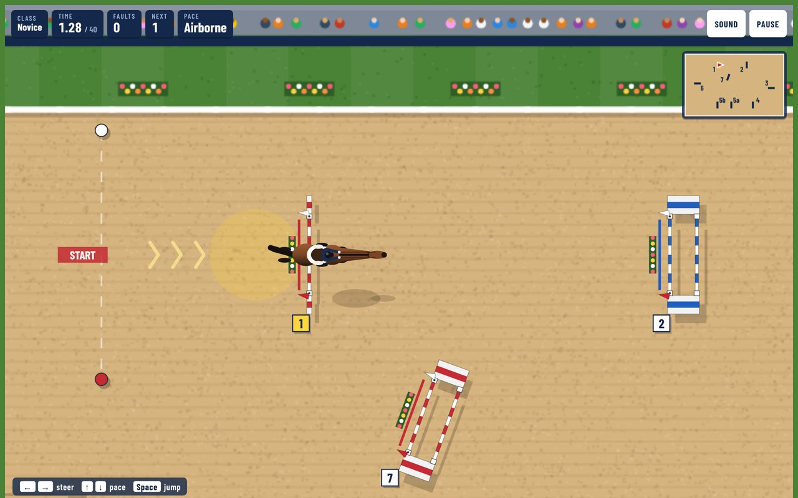
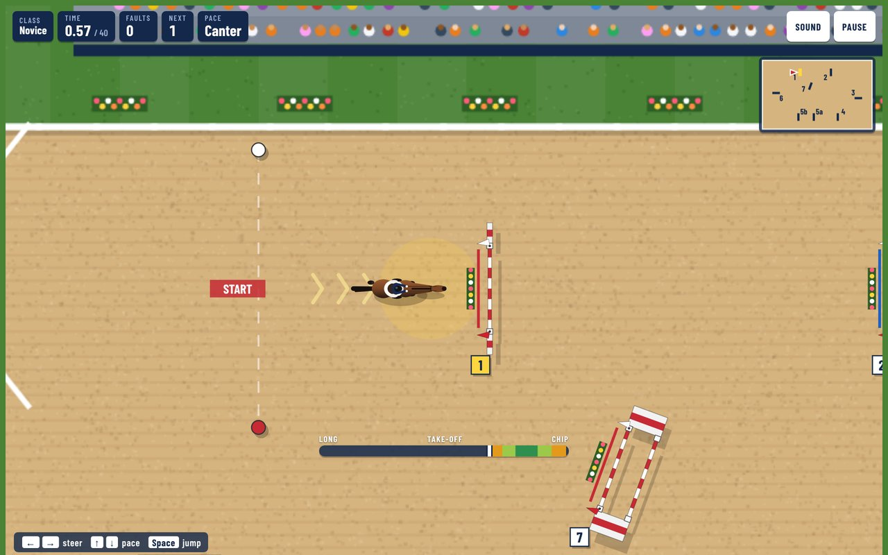
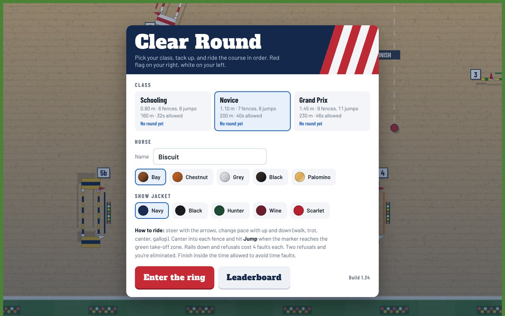
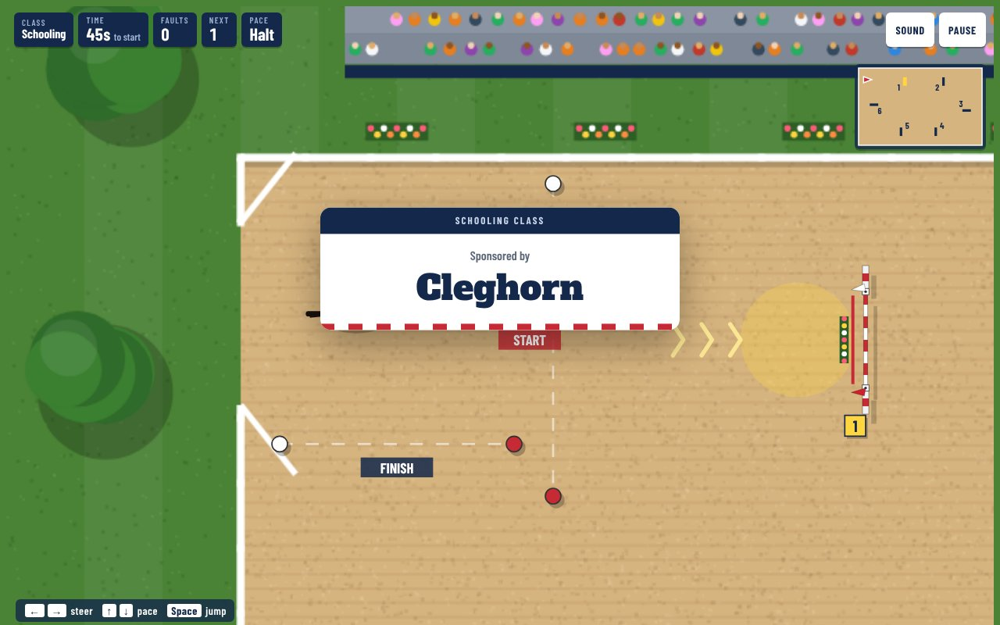
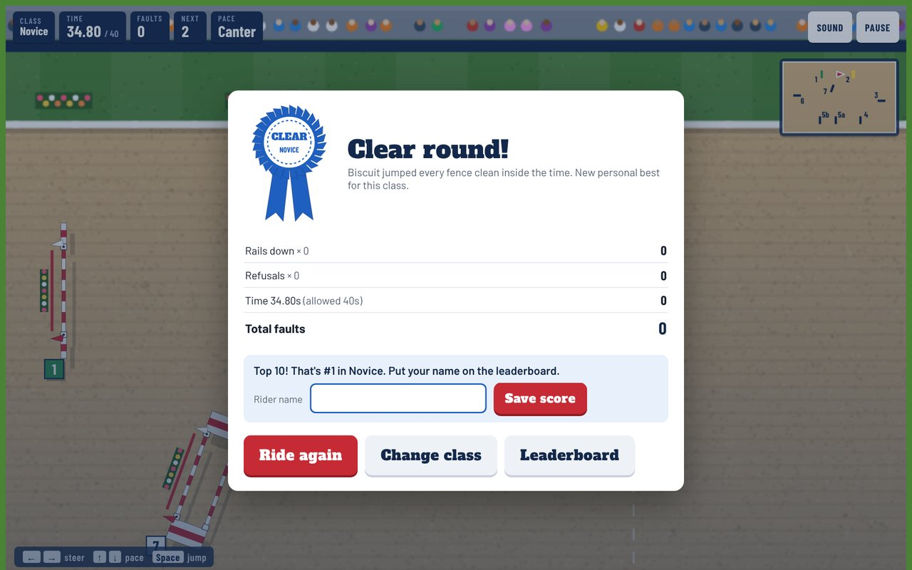
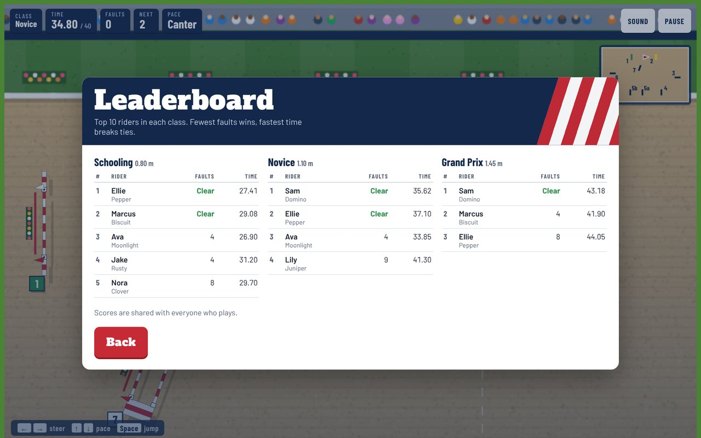
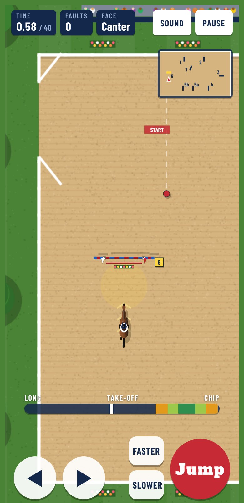

# Clear Round

A top-down show jumping game. Ride your horse around a numbered course in the ring, time your take-offs, and go for a clear round.

**Play it at https://grey-lancaster.github.io/Clear-Round/**

## How to ride

- **Steer:** left/right arrows (or the on-screen buttons on a phone)
- **Pace:** up/down to change between walk, trot, canter and gallop
- **Jump:** Space, when the marker reaches the green take-off zone

Rails down and refusals cost 4 faults each. Two refusals and you're eliminated. Finish inside the time allowed to avoid time faults.

## Classes

Pick a class, name your horse, and choose its coat and your show jacket.

| Class | Height | Course |
| --- | --- | --- |
| Schooling | 0.80 m | 6 fences |
| Novice | 1.10 m | 7 fences, with a double |
| Grand Prix | 1.45 m | 9 fences, with a triple combination and a water jump |

## Sponsors

When a rider enters the ring, a sponsor card flashes up for that class. The start bell and the 45-second start clock wait until the cards are done, so they never cost the rider time. The Schooling class is sponsored by Cleghorn.

Sponsors are listed in `SPONSORS` near the top of the script in `docs/index.html`. Each class can have several, shown one after another, each with a name, an optional tag line and an optional logo (put the image in `docs/sponsors/`).

## Leaderboard

Each class keeps a top 10. Fewest faults ranks first, so clear rounds always lead, and the fastest time breaks ties. A round that makes the top 10 asks for the rider's name; eliminated rounds don't count. Scores come from the game's own results; players only type their name.

| Results after a clear round | Shared leaderboard |
| --- | --- |
|  |  |

*The leaderboard screenshot uses sample scores.*

### Setting up the shared leaderboard

Scores are stored in a Supabase table. If it isn't configured or can't be reached, scores are saved only in each player's browser. To set it up:

1. Create a free project at supabase.com.
2. Open the SQL Editor, paste in `supabase-setup.sql`, and run it.
3. In Project Settings → API, copy the Project URL and the publishable (`anon`) key into the `LB` line near the top of the script in `docs/index.html`. Never put the secret / `service_role` key there.

## On a phone

## Files

- `docs/index.html` is the whole game, served by GitHub Pages from the `docs` folder.
- `docs/favicon.ico` is the fox icon.
- `docs/sponsors/` holds sponsor logos for the sponsor cards (see the `SPONSORS` list in `docs/index.html`).
- `supabase-setup.sql` creates the leaderboard table.
- `screenshots/` holds the pictures in this README.
